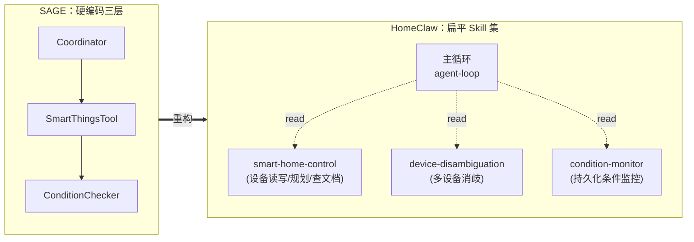
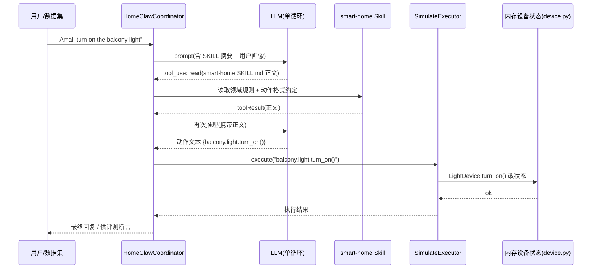

# 02 · 总体架构设计

## 1. 架构总览

HomeClaw 采用「**一个 Skill + 一个统一 Runner + 双评测适配器 + 可插拔执行器**」的分层结构，将两套 Benchmark 都喂给同一个 Agent 内核。

```mermaid
graph TD
    subgraph IN["输入层"]
        D1["SAGE 数据集<br/>'&lt;user&gt;: &lt;command&gt;' + 初始设备状态"]
        D2["HomeBench 数据集<br/>home_status + method(指令)"]
    end

    subgraph SK["① 能力层：HomeClaw Skill（OpenClaw 生态）"]
        MD["smart-home.SKILL.md<br/>迁移自 SAGE prompts + HomeBench system.txt<br/>规定输出 room.device.op(param) 或 error_input"]
    end

 subgraph RT["② 编排层：HomeClawCoordinator"]
        LOOP["单主循环 + Function-Calling<br/>(OpenClaw agent-loop 式)<br/>对外暴露 SAGE 兼容 execute() 接口"]
        PARSE["意图 → 动作文本解析"]
    end

    subgraph EX["③ 执行层：ActionExecutor（可插拔）"]
        X1["SimulateExecutor(默认)<br/>调 device.py 仿真类，改内存状态"]
     X2["RealDeviceExecutor(预留)<br/>SmartThings / Home Assistant"]
    end

    subgraph EV["④ 评测层：双适配器"]
        E1["SageEvalAdapter<br/>五维·动态执行→断言状态"]
        E2["HomeBenchEvalAdapter<br/>幻觉·静态文本→EM/P/R/F1"]
    end

    subgraph BL["⑤ 对照组"]
        B1["SAGECoordinator"] & B2["SashaCoordinator"] & B3["OnePromptCoordinator"] & B4["HomeClawCoordinator ★"]
    end

    D1 --> RT
    D2 --> RT
    MD --> LOOP
    LOOP --> PARSE --> X1
    PARSE -.预留.-> X2
    E1 --> RT
    E2 --> RT
    E1 -.驱动.-> B1 & B2 & B3
    E2 -.驱动.-> B1 & B2 & B3
    B4 --- LOOP
```



---

## 2. 分层职责

| 层 | 组件 | 职责 | 资产来源 |
|---|---|---|---|
| ① 能力层 | `smart-home.SKILL.md` | 承载领域知识、动作格式约定、幻觉规则 | SAGE prompts + HomeBench system.txt |
| ② 编排层 | `HomeClawCoordinator` | 单主循环调度 LLM，解析意图为动作文本，暴露 `execute()` | OpenClaw 范式 + SAGE 接口 |
| ③ 执行层 | `ActionExecutor` 及其实现 | 动作文本落地（仿真 / 真机） | HomeBench device.py |
| ④ 评测层 | 双适配器 | 五维断言 + 幻觉六型文本比对 | SAGE testcases + HomeBench eval |
| ⑤ 对照组 | 四个 Coordinator | 同数据同指标对比 | SAGE 已有三个 + 新增 HomeClaw |

---

## 3. 从 SAGE Agent-as-Tool 到 HomeClaw 单主循环

### 3.1 范式对比

| 维度 | SAGE（旧） | HomeClaw（新） |
|---|---|---|
| 组织 | 三层 Agent 静态嵌套（代码写死层级） | 单主循环 + 扁平 Skill 懒加载 |
| 能力描述 | 全部工具 description 一次性塞 prompt | 摘要 + 用到才 `read` 全文（两级检索） |
| 编排决策 | LangChain ReAct 文本解析（Thought/Action/Observation） | 原生 Function-Calling（结构化 tool_use） |
| 扩展方式 | 新增 ToolConfig 类 + 改 tool_configs | 丢一个 SKILL.md 即被发现 |
| 成本 | 每下钻一层多一轮/多个 LLM 调用 | 单循环，调用轮数显著更少 |

### 3.2 能力拆分：三层嵌套 → 扁平 Skill 集

SAGE 的三层 Agent 被拆成扁平的能力单元，由主循环按需加载：



> **契约不变**：无论叶子能力还是内嵌复杂逻辑的能力，对主循环都只是「name + description + 按需正文」。这正是可扩展性的根本。

---

## 4. HomeClawCoordinator 接口设计（草案）

为了能无缝接入 SAGE 的 `test_runner.py`，`HomeClawCoordinator` **必须实现 SAGE 的 `execute()` 契约**，同时内部走 OpenClaw 单循环。

```python
# 设计示意（非最终实现）
class HomeClawCoordinator:
    """OpenClaw 单循环内核，对外兼容 SAGE Coordinator 接口。"""

    def __init__(self, config: HomeClawCoordinatorConfig):
    self.skill = load_skill("smart-home") # 加载 SKILL.md
        self.executor = config.executor            # SimulateExecutor / RealDeviceExecutor
    self.llm = config.llm

    # —— SAGE 兼容接口：五维评测走这里 ——
    def execute(self, user_command: str) -> str:
 """输入 '<user>: <command>'，内部单循环 + FunctionCalling，
     产出动作文本并经 executor 落地改状态，返回最终自然语言回复。"""
      actions = self._run_agent_loop(user_command)   # 可能多轮 tool_use
        for action in actions:
            self.executor.execute(action)     # 改内存状态（供 SAGE 断言）
    return self._final_reply()

    # —— HomeBench 兼容接口：幻觉评测走这里 ——
    def predict_actions(self, home_status: dict, instruction: str) -> str:
      """只输出动作文本 {room.device.op(param)} / error_input，不落地，
        供 HomeBenchEvalAdapter 做字符串比对。"""
        return self._run_agent_loop_text_only(home_status, instruction)
```

> **一份内核，两个入口**：`execute()` 供 SAGE（执行后查状态），`predict_actions()` 供 HomeBench（只比文本）。两者共享同一个单循环与同一个 Skill。

---

## 5. 与 OpenClaw 的关系

- HomeClaw **不修改** OpenClaw 内核；
- `smart-home` Skill 遵循 OpenClaw 的 SKILL.md 契约，可被其 Runtime 发现与懒加载；
- `HomeClawCoordinator` 复用 OpenClaw 的单循环思想（`agent-loop` 式 while 循环 + Function-Calling + toolResult 回传）；
- 若直接跑在 OpenClaw Runtime 上，则 `execute()` / `predict_actions()` 作为上层封装调用其 `prompt()`。

---

## 6. 数据流：一条指令的生命周期

以 `Amal: turn on the balcony light` 为例：



> 对 HomeBench 路径，则在「产出动作文本」后直接返回文本，**不经过 Executor 落地**，交给文本比对评测。
