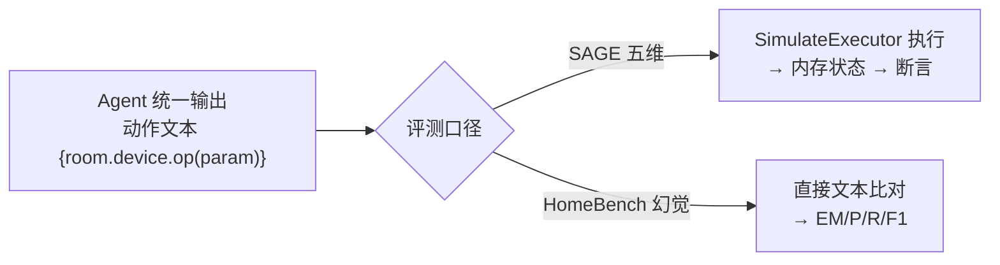

# 03 · 评测体系设计

HomeClaw 的评测体系由**三大板块**组成，全部在「四个被测系统 × 两个数据集」的矩阵下展开：

1. **五维评测**（SAGE 数据集）— 任务挑战难度
2. **幻觉评测**（HomeBench 数据集）— 合法性 × 数量
3. **新增维度评测**（SAGE 数据集）— 效率与鲁棒性

被测系统（对照组）：`HomeClaw` / `SAGE` / `Sasha` / `One Prompt`。

---

## 1. 板块一：五维评测（复用 SAGE）

### 1.1 五个维度定义

| 维度 | 英文 | 考察点 | 示例 |
|---|---|---|---|
| 个性化 | Personalization | 结合用户画像/记忆 | "Amal 喜欢暖光" → 开灯并调暖色 |
| 意图理解 | Intent resolution | 模糊/隐含意图澄清 | "太亮了" → 调低亮度 |
| 设备定位 | Device resolution | 多同类设备中定位目标 | 有 TV 和 Frame TV → 选对 |
| 持久化监控 | Persistence | 条件触发的长期监控 | "冰箱门开着就开灯" |
| 指令链 | Command chaining | 多步依赖动作编排 | "回家模式"=开灯+调温+放音乐 |

### 1.2 复用机制

直接沿用 SAGE 的装饰器注册与集合筛选：

```python
# SAGE 原有机制，HomeClaw 直接复用
TEST_REGISTER = {"device_resolution": set(), "personalization": set(),
     "persistence": set(), "intent_resolution": set(),
   "command_chaining": set(), "simple": set(), "test_set": set(), ...}

@register(["device_resolution"])
def turn_on_tv(device_state, config):
    device_state[tv_id][...]["value"] = "off"
    test_id, coordinator = setup(device_state, config.coordinator_config)
    coordinator.execute("Amal: turn on the TV")     # ← HomeClaw 也实现该接口
    device_state = db.get_device_state(test_id)
    assert device_state[tv_id][...]["value"] == "on"
```

### 1.3 接入 HomeClaw：唯一改动

在 SAGE `test_runner.py` 的 `CoordinatorType` 枚举里增加一项即可四系统同台：

```python
class CoordinatorType(Enum):
    SAGE = SAGECoordinatorConfig
    SASHA = SashaCoordinatorConfig
    ZEROSHOT = OnePromptCoordinatorConfig
    HOMECLAW = HomeClawCoordinatorConfig     # ★ 新增
```

> **去数据库改造**：SAGE 原用 MongoDB 存 `device_state`。HomeClaw 方案用 `SimulateExecutor` 的内存状态替代 `db.get_device_state()`，保留断言逻辑但去掉 Mongo 依赖（见文档 04）。

### 1.4 判定方式（沿用 SAGE 两类）

- **状态断言（确定性）**：改设备类用例直接比对内存设备状态数值。
- **LLM-as-Judge（开放问答）**：问答/总结类用固定 GPT-4（temperature=0）做 yes/no 裁判。

---

## 2. 板块二：幻觉评测（复用 HomeBench）

### 2.1 六型分类

| 类型（`type`） | 归类 | 含义 | 期望输出 |
|---|---|---|---|
| `normal` | **valid single** | 单条合法指令 | 正确动作文本 |
| `unexist_device` | **invalid single** | 操作不存在的设备 | `error_input` |
| `unexist_attribute` | **invalid single** | 操作不存在的属性/方法 | `error_input` |
| `*_normal`(multi) | **valid multi** | 多条全合法 | 多个动作文本 |
| `*_error`(multi) | **invalid multi** | 多条全非法 | 多个 `error_input` |
| `*_mix`(multi) | **multi mix** | 合法+非法混合 | 动作与 error_input 混合 |

### 2.2 复用 eval.py 分型统计

```python
# HomeBench eval.py 的分型逻辑，HomeClaw 直接复用
if item["type"] == "normal":         normal_single[...]
elif item["type"] == "unexist_device":    unexist_device_single[...]
elif item["type"] == "unexist_attribute": unexist_attribute_single[...]
else:
    tmp = item["type"].split("_")[1]
    if tmp == "mix":      mix_multi[...]
  elif tmp == "normal": normal_multi[...]
    else:      error_multi[...]
```

### 2.3 指标

对每型分别计算：

| 指标 | 含义 |
|---|---|
| **EM (Exact Match)** | 整条指令集完全匹配率 |
| **Precision** | 输出的动作中正确的比例（衡量过度执行/幻觉） |
| **Recall** | 应输出的动作中被覆盖的比例（衡量漏执行） |
| **F1** | P/R 调和平均 |
| **error_input 准确率** | 对非法项正确拒答的比例（核心幻觉指标） |

### 2.4 接入 HomeClaw：`predict_actions()` + 配置化 eval

- 让四个 Coordinator 都实现 `predict_actions(home_status, instruction)`，输出动作文本；
- 写 `HomeBenchRunner`，把 `home_status + method` 塞进各系统的 prompt，收集文本；
- **改造 eval.py**：把 `/home/slli/...` 硬编码绝对路径改为相对路径 + 传参配置化。

> **这是本项目最亮的论点来源**：HomeBench 原来只测「裸 LLM」，HomeClaw 首次让**四个 Agent 架构**在同一幻觉数据集上对比，量化「Agent 架构对幻觉抑制的贡献」。

---

## 3. 板块三：新增维度评测（用 SAGE 数据集的其他维度）

> 满足用户「能否有其他维度的对比（仍使用 SAGE 数据集）」的要求。

### 3.1 过度执行率 / 拒答率

借鉴 HomeBench 的 `error_input` 思想，**反向套用**到 SAGE 数据集：

- 对 SAGE 中的模糊/边界指令，统计模型是否**幻觉出多余动作**（过度执行）；
- 统计对应拒答/澄清而非盲目执行的比例（拒答率）。
- 这弥补了 SAGE 原本「只看做对没做对，不看做多了没有」的盲区。

| 指标 | 定义 |
|---|---|
| 过度执行率 | 产生超出指令要求的额外动作的用例占比 |
| 正确拒答率 | 对不可执行/模糊指令正确澄清或拒答的占比 |

### 3.2 效率维度（HomeClaw 天然优势点）

| 指标 | 说明 | 预期结论 |
|---|---|---|
| 平均 LLM 调用轮数 | 单用例完成所需 LLM 请求次数 | HomeClaw 单循环 < SAGE 三层嵌套 |
| 平均 token 成本 | prompt + completion 累计 token | HomeClaw 两级检索省 token |
| 端到端延迟 | 单用例墙钟耗时 | HomeClaw 更低 |

### 3.3 鲁棒性维度（可选）

| 指标 | 说明 |
|---|---|
| 解析失败率 | LLM 输出无法解析为合法动作文本的比例（ReAct 文本解析 vs Function-Calling 的对比点） |
| 多步一致性 | 指令链场景下动作顺序/依赖正确率 |

---

## 4. 评测矩阵总览

```
     数据集
             ┌──────────────┬──────────────────┐
  │  SAGE 数据集  │   HomeBench 数据集 │
   ┌─────────┼──────────────┼──────────────────┤
   │HomeClaw │ 五维 + 新增维度 │  幻觉六型 EM/P/R/F1 │
被 │SAGE│ 五维 + 新增维度 │  幻觉六型 EM/P/R/F1 │
测 │Sasha    │ 五维 + 新增维度 │  幻觉六型 EM/P/R/F1 │
系 │OnePrompt│ 五维 + 新增维度 │  幻觉六型 EM/P/R/F1 │
统 └─────────┴──────────────┴──────────────────┘
```

**输出物**：
1. 五维对比表（4 系统 × 5 维 通过率）
2. 幻觉六型对比表（4 系统 × 6 型 × EM/P/R/F1）
3. 新增维度对比表（4 系统 × 过度执行率/拒答率/调用轮数/token/延迟）

---

## 5. 「一份输出喂两套评测」的关键设计

由于 SAGE 是「执行后查状态」、HomeBench 是「比字符串」，口径不同。统一方案：



Agent 只需产出一种动作文本；SAGE 侧多走一步「仿真执行得状态」，HomeBench 侧直接比文本。避免维护两套输出逻辑。
