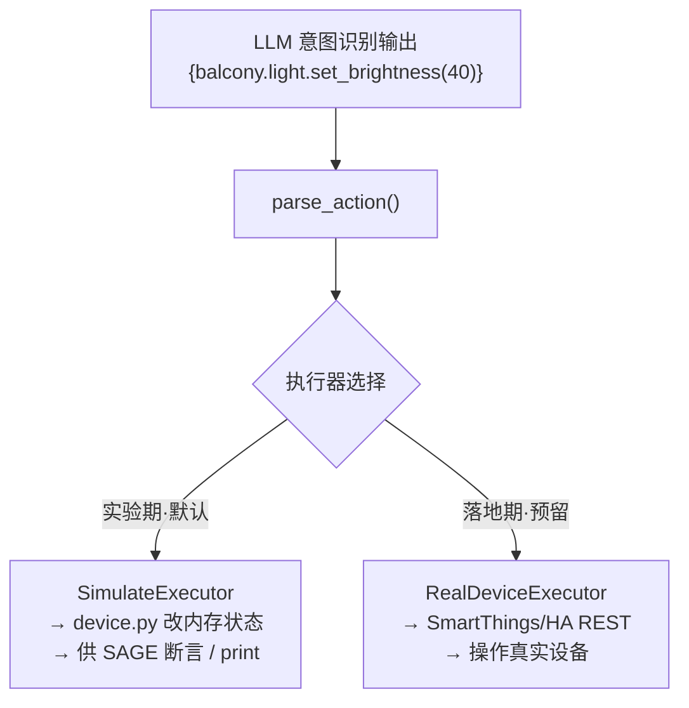

# 04 · 动作仿真与可插拔执行器

> 对应用户第三条要求：HomeClaw 能仿真输出意图识别后的动作（如 `balcony.light.set_brightness(40)`），降低实验难度，同时预留真机接口。

## 1. 动作文本格式契约

HomeClaw 所有意图识别的输出统一为**动作文本**，格式与 HomeBench 完全一致（见 `HomeBench/code/example.txt`）：

```
{room.device.operation(param)}
```

### 1.1 格式规则

| 规则 | 说明 | 示例 |
|---|---|---|
| 基本结构 | `房间.设备.操作(参数)` | `balcony.light.set_brightness(40)` |
| 无参操作 | 括号为空 | `living_room.light.turn_off()` |
| 房间名下划线 | 多词房间用下划线 | `guest_bedroom.air_conditioner.set_temperature(26)` |
| 多动作 | 花括号内逗号分隔 | `{corridor.aromatherapy.set_intensity(30), living_room.media_player.set_volume(0)}` |
| **幻觉拒答** | 不存在设备/属性/方法 | `error_input` |
| 混合场景 | 合法与 error_input 混排 | `{corridor.aromatherapy.set_intensity(30), error_input, living_room.media_player.set_volume(0)}` |

### 1.2 error_input 规则（幻觉核心）

> 摘自 HomeBench example.txt：
> *"If there is no device or if there is no attribute or method that can be operated on the device, please output as `error_input`."*

- 房间不存在 → `error_input`
- 设备不存在于该房间 → `error_input`
- 设备存在但无此属性/操作 → `error_input`
- 多动作中某一项非法 → 该项位置输出 `error_input`，其余正常

---

## 2. ActionExecutor 抽象接口

执行层采用**可插拔策略模式**，把「动作文本」与「如何落地」解耦：

```python
# 设计示意（非最终实现）
from abc import ABC, abstractmethod

class ActionExecutor(ABC):
    @abstractmethod
def execute(self, action: str) -> dict:
  """输入单条动作文本，返回执行结果 {status, detail}。"""
      ...

    def execute_batch(self, actions: list[str]) -> list[dict]:
        return [self.execute(a) for a in actions]
```

### 2.1 动作文本解析器（parser）

Executor 内部先用解析器把动作文本拆解：

```python
import re

ACTION_RE = re.compile(r"^\s*(\w+)\.(\w+)\.(\w+)\((.*)\)\s*$")

def parse_action(action: str):
    """'balcony.light.set_brightness(40)'
       → ('balcony', 'light', 'set_brightness', [40])"""
    if action.strip() == "error_input":
        return None   # 幻觉拒答标记
    m = ACTION_RE.match(action)
    if not m:
        raise ActionParseError(action)
    room, device, op, arg_str = m.groups()
    args = _parse_args(arg_str)        # 数字/字符串/元组(颜色)
    return room, device, op, args
```

---

## 3. SimulateExecutor（默认，实验期）

直接复用 HomeBench `visual_home/device.py` 的可执行仿真类（`LightDevice.set_brightness()` 等），仅改内存状态并 print，**无需真实设备、无需数据库**。

```python
# 设计示意（非最终实现）
class SimulateExecutor(ActionExecutor):
    """默认执行器：解析动作 → 调 device.py 仿真类 → 改内存状态。"""

    def __init__(self, home: dict):
        # home = {room: {device_name: DeviceObj}}，由数据集初始状态构建
 self.home = home

    def execute(self, action: str) -> dict:
        parsed = parse_action(action)
        if parsed is None:
      return {"status": "rejected", "reason": "error_input"}  # 幻觉拒答

        room, device, op, args = parsed
        # —— 幻觉校验：不存在则等价 error_input ——
        if room not in self.home:
   return {"status": "error", "reason": "unexist_room"}
     if device not in self.home[room]:
     return {"status": "error", "reason": "unexist_device"}
        obj = self.home[room][device]
        if op not in obj.operations:
 return {"status": "error", "reason": "unexist_attribute"}

        # —— 真正执行仿真 ——
  obj.operations[op](*args)          # 例如 LightDevice.set_brightness(40)
   return {"status": "ok", "state": obj.get_status()}
```

映射示意（对接 `device.py`）：

```35:42:/Users/xiwenluo/work/OpenClaw/HomeBench/visual_home/device.py
    def set_brightness(self, brightness: int):
        if self.state == "off":
       print("Cannot set brightness while device is off.")
     else:
    self.attributes["brightness"]["value"] = brightness
       print(f"Brightness set to {brightness}.")
```

> `SimulateExecutor` 修改后的内存状态，正好供 **SAGE 五维评测**做状态断言（替代原 `db.get_device_state()`），实现「去 MongoDB」。

### 3.1 house 构建

从数据集初始状态构建 `home` 字典：

```python
def build_home(home_status: dict) -> dict:
    """把数据集里的初始设备状态映射为 device.py 对象树。"""
    home = {}
    for room, devices in home_status.items():
        home[room] = {}
        for dev_name, dev_state in devices.items():
 cls = DEVICE_CLASS_MAP[dev_name]        # light→LightDevice ...
     obj = cls(state=dev_state.get("state", "off"))
         obj.initialize(dev_state["state"], dev_state.get("attributes"))
    home[room][dev_name] = obj
    return home
```

---

## 4. RealDeviceExecutor（预留，落地期）

同一套动作文本，改为发真实 API，**格式零改动**：

```python
# 设计示意（预留接口，本阶段不实现）
class RealDeviceExecutor(ActionExecutor):
  """预留：把动作文本映射为真实厂商 API 调用。"""

    def __init__(self, adapter: "DeviceCloudAdapter"):
        self.adapter = adapter    # SmartThings / Home Assistant 适配器

    def execute(self, action: str) -> dict:
  parsed = parse_action(action)
        if parsed is None:
            return {"status": "rejected", "reason": "error_input"}
        room, device, op, args = parsed
    # TODO(落地期): 映射到 SmartThings/Home Assistant REST
        #   device_id = self.adapter.resolve(room, device)
        #   return self.adapter.call(device_id, op, args)
        raise NotImplementedError("RealDeviceExecutor 为预留接口")
```

### 4.1 适配器接口契约（预留）

```python
class DeviceCloudAdapter(ABC):
    @abstractmethod
    def resolve(self, room: str, device: str) -> str: ...   # → device_id
    @abstractmethod
    def call(self, device_id: str, op: str, args: list) -> dict: ...
```

> 未来接 SmartThings（借鉴 SAGE 的 `SmartThingsTool` REST 调用与 `most_similar_id` 容错）或 Home Assistant，只需实现 `DeviceCloudAdapter`。

---

## 5. 仿真 vs 真机：一套格式，两种落地



| 特性 | SimulateExecutor | RealDeviceExecutor |
|---|---|---|
| 阶段 | 实验/评测（默认） | 生产落地（预留） |
| 依赖 | 无（纯内存） | 厂商云 API + 认证 |
| 动作格式 | `room.device.op(param)` | **完全相同** |
| 副作用 | 改内存状态 + print | 操作真实设备 |
| 用途 | 降低实验难度、可复现 | 真实控制 |

> **核心价值**：动作文本格式在仿真与真机间完全一致，实验到落地**零格式改动**，只切换 Executor 实现即可。

---

## 6. 持久化（Persistence）维度的仿真处理

SAGE 的持久化依赖 Trigger Server 轮询。纯仿真下的处理方案：

- 在 `SimulateExecutor` 内加一个**条件事件队列**，模拟「条件满足→二次触发」；
- LLM 现写的条件函数（SAGE `code_registry` 思路）存入内存注册表；
- 评测时手动/脚本推进状态变化，检查是否正确触发后续动作。

> 该方案已在 M4 落地（见文档 05 里程碑 M4），持久化维度改由内存条件事件队列驱动，无需 Trigger Server。
