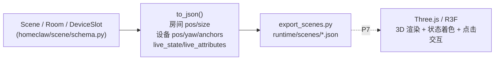
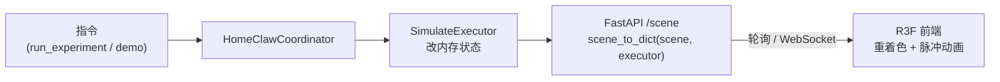
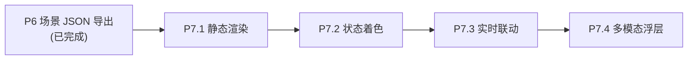

# 06 · 3D 场景可视化实施方案（P7）

> **一句话定位**：把 P6 已导出的场景 JSON（房间/设备/3D 坐标/实时状态）搬上浏览器，用 **Three.js（React Three Fiber）** 渲染成可交互的 3D 智能家居，直观展示「房间—设备—状态变化」，并把 SAGE 的实景照片消歧能力作为对比亮点呈现。

---

## 文档状态

| 项 | 说明 |
|---|---|
| 文档类型 | **实施方案（Implementation Plan）** |
| 当前阶段 | P6（场景 JSON 导出）已完成，**P7 3D 可视化已落地**（`web/` 前端 + `web/server.py` 只读接口，P7.1~P7.4 全部完成） |
| 版本 | v0.4 |
| 最后更新 | 2026-09-08 |
| 作者 | HomeClaw 项目组 |

> 本文承接 [05-实施路线与目录结构.md](./05-实施路线与目录结构.md) 的 P 阶段路线，是 P7 的落地蓝图。文中代码块除已标注文件路径者外，均为**设计示意（非最终实现）**。

---

## 1. 背景与衔接

P6 已经把两套场景抽象为**天然的 3D 场景描述**并落盘（`export_scenes.py` → `runtime/scenes/*.json`）：



P7 **不改场景抽象**，只做两件事：① 前端读 JSON 建 3D 房子；② 一个 10 行的只读 HTTP 接口把 executor 实时状态推给前端，实现「跑一条指令 → 3D 里颜色变」。

---

## 2. 技术选型

### 2.1 结论

**Three.js + React Three Fiber（R3F）**，纯前端、零后端渲染，数据源为 P6 的场景 JSON。

理由：`to_json()` 输出的 `pos/size/yaw/live_state` 已是场景图描述，R3F 的声明式 JSX 让 `state → 重渲染` 天然契合「状态变化驱动 3D」，无需自己维护渲染循环。

### 2.2 选型对比

| 方案 | 适合度 | 说明 |
|---|---|---|
| **Three.js + React Three Fiber** | ✅ 首选 | 生态最大；房间/设备/发光/点击交互均现成；state 驱动重渲染契合本项目 |
| 原生 Three.js | 可选 | 不想引入 React 时用；需手写场景图，交互样板代码偏多 |
| Babylon.js | 备选 | 功能全但偏重，学术 demo 无必要 |
| Unity / UE + WebGL | ❌ 过重 | 构建与嵌入成本高，论文 demo 不值当 |
| 2D 平面图（SVG/Canvas） | 降级 | 时间紧时先做俯视 2D 验证数据链路，再升 3D |

---

## 3. 数据契约：场景 JSON → 3D 元素

沿用 P6 `Scene.to_json()`（见 `homeclaw/scene/schema.py`）的既有字段，映射规则如下：

| JSON 字段 | 3D 元素 | 渲染规则 |
|---|---|---|
| `room.pos` / `room.size` | 房间 | 半透明 `BoxGeometry`，`size=(w,d,h)` 直接摆位 |
| `device.pos` / `device.yaw` | 设备 | 小图元或 glTF（按 `device.model` 选资源），摆在 `room.pos + device.pos` |
| `device.exists=false` | 干扰设备 | 灰色半透明/虚线包围盒，标注「不存在（HomeBench 干扰）」 |
| `device.live_state` | 设备状态 | `on`→自发光/绿；`off`→灰（详见 §5） |
| `device.live_attributes` | 状态细节 | 亮度→发光强度；温度→色温；音量→图标 badge |
| `device.anchors` | SAGE 空间锚点 | 设备旁悬浮文本标签（「by the credenza / plant…」） |
| `device.image`（新增） | SAGE 实景照片 | 点击设备弹出实景照片（详见 §4） |

### 3.1 坐标系约定（动手前必须定死）

`schema.py` 注释为 `size=(w,d,h)`（**Z-up**：z 为高度），而 Three.js 默认 **Y-up**。约定：

- **数据侧统一 Z-up**（沿用现有 schema，不改）；
- **前端加载时做一次 `Z-up → Y-up` 转换**（`(x, y, z) → (x, z, y)`），集中在一个 `toThree()` 工具函数里，杜绝「3D 摆出来躺平」。

---

## 4. 多模态（SAGE 实景照片）处理

SAGE 的多模态本质：**同类多实例设备各配一张实景照片（`UUID.jpg`），用 CLIP 做「口语空间描述 ↔ 实景」图文消歧**——这是 SAGE `device_resolution` 维度的独特能力，HomeBench 没有，正好作为 3D 对比亮点。

> **关键事实（已核实）**：SAGE 只有 **6 张图**，恰好对应**需要消歧的同类多实例设备**（4 盏灯彼此、2 台电视彼此）；`fridge`/`dishwasher` 家中唯一、无需消歧，故**无图**。图片文件名即设备 UUID（`SAGE/sage/testing/testcases.py`）。

### 4.1 数据搬运（对齐 P1「数据自包含」）· 已落地

1. 已把 `SAGE/sage/testing/assets/images/*.jpg`（6 张 UUID 命名）拷入 `HomeClaw/data/sage/images/`；
2. `DeviceSlot` 已补两字段（`homeclaw/scene/schema.py`，挂在设备上，不改整体结构）：

```python
# homeclaw/scene/schema.py · DeviceSlot（已实现）
image: Optional[str] = None          # 实景照片相对路径，如 "sage/images/<uuid>.jpg"
device_uuid: Optional[str] = None    # 对齐 SAGE testcases 的真实设备 UUID
```

3. `to_json()` 的设备节点已带出 `image` / `device_uuid`（其余逻辑不变）；
4. `sage_scene.py` 已按下表真实 UUID 给这 **6 台**设备填 `image`/`device_uuid`，另 2 台留空。

**真实 UUID ↔ 设备映射（从 testcases.py 抠出，已写入代码）：**

| device_uuid（= 图片文件名） | HomeClaw slot | 空间锚点 |
|---|---|---|
| `22e11820-…de298` | bedroom.nightstand_light | by the bed |
| `571f0327-…9522d` | living_room.fireplace_light | by the fireplace |
| `363f714d-…42709` | living_room.tv_light | by the tv / by the light |
| `c4b4a179-…6afc6` | dining_room.dining_table_light | over the dining table |
| `8e20883f-…c70e2` | living_room.tv（main tv） | by the credenza |
| `415228e4-…7fba8` | living_room.frame_tv | by the plant |
| — | kitchen.fridge / kitchen.dishwasher | 无图（家中唯一，无需消歧） |

> 图片存**相对路径 + 经 `data_paths.DATA_DIR` 解析**（对齐 P1 风格），不存绝对路径，保证可复现。

### 4.2 前端呈现（含降级诚实声明）

- 设备节点点击 → 弹「实景照片 + anchors 文本」浮层，直观展示「SAGE 靠实景 + 空间锚点消歧」；
- HomeBench 场景无 `image`/`anchors`，浮层自然退化为纯状态卡片——两套场景的差异在同一 UI 下一目了然。

> **降级声明（延续 MemoryBank 的诚实标注）**：3D 里展示的是 SAGE **实景照片资产的可视化**，CLIP 图文消歧本身仍由**后端**（或降级实现）完成，前端并未在浏览器里跑 VLM 推理。文档/论文表述须避免「前端做了 VLM 推理」的错觉。

---

## 5. 状态可视化映射

「直观展示状态变化」的核心是**材质/颜色驱动**：

| 状态来源 | 视觉编码 |
|---|---|
| `live_state == "on"` | 自发光（emissive）+ 绿色描边 |
| `live_state == "off"` | 灰色、低亮度 |
| 灯 `brightness` | 发光强度线性映射 |
| 空调/冰箱 `temperature` | 冷暖色温（低温偏蓝、高温偏橙） |
| 媒体 `volume` / 香薰 `intensity` | 设备上方数值 badge |
| 动作发生瞬间 | 0.3s 高亮脉冲动画，提示「刚刚变化」 |

R3F 下这些都是 `state → 材质 props` 的声明式绑定，executor 状态一变、下一帧自动重着色。

---

## 6. 实时联动

### 6.1 数据流



### 6.2 只读接口（10 行，复用现成 `scene_to_dict`）

`homeclaw/scene/export.py` 已提供 `scene_to_dict(scene, executor)`（不落盘，直接返回 dict），P7 只需一层薄 HTTP：

```python
# 设计示意：web/server.py
from fastapi import FastAPI
from homeclaw.scene import build_sage_scene, scene_to_dict
from homeclaw.executor import make_executor

app = FastAPI()
scene = build_sage_scene()
ex = make_executor("sim", home_status=scene.to_home_status())

@app.get("/scene")
def get_scene():
    return scene_to_dict(scene, ex)     # 带 live_state 的完整 3D JSON

@app.post("/act")
def act(action: str):
    return ex.execute(action)           # 前端点按或指令驱动
```

> 全程 `--executor sim` 离线可演示，无需真机、无需数据库（对齐 00 的「可复现优先」）。

---

## 7. 目录结构（前端新增）

```
HomeClaw/
├── web/  # P7 新增：3D 可视化前端
│   ├── index.html
│   ├── package.json # three / @react-three/fiber / @react-three/drei
│   ├── server.py   # FastAPI 只读接口（§6.2）
│   └── src/
│       ├── SceneCanvas.tsx      # R3F 画布：读 /scene，建房间/设备
│       ├── Room.tsx    # 房间盒子（pos/size → Y-up）
│       ├── Device.tsx           # 设备图元 + 状态着色 + 点击浮层
│       ├── DevicePopup.tsx      # SAGE 实景照片 + anchors 浮层
│       └── lib/toThree.ts       # Z-up → Y-up 坐标转换
├── data/sage/images/         # P7 新增：SAGE 实景照片（6 张 UUID.jpg）
└── runtime/scenes/*.json       # P6 已产出，前端可直接静态读取
```

---

## 8. 里程碑分解



| 子里程碑 | 目标 | 交付物 | 依赖 |
|---|---|---|---|
| **P7.1** | 静态渲染 | 读 `sage_scene.json`/`homebench_scene.json` → 建出房间+设备（Z→Y 转换、相机/光照/轨道控制器） | P6 JSON |
| **P7.2** | 状态着色 | on/off/亮度/温度 → 材质映射；`exists=false` 干扰设备灰显 | P7.1 |
| **P7.3** | 实时联动 | `web/server.py` + 前端轮询/WS；跑一条指令 → 3D 颜色变 + 脉冲动画 | P7.2、executor |
| **P7.4** | 多模态浮层 | `DeviceSlot` 补 `image/device_uuid`；SAGE 实景照片 + anchors 点击浮层 | P7.1、图片搬运 |

> **落地状态（v0.4）**：P7.1~P7.4 已全部实现于 `web/`。后端 `web/server.py`（FastAPI 只读 `/scene` `/scenes/{source}` `/act` + `/images` 静态映射），复用 P6 `scene_to_dict`、executor 走 `sim`；前端 R3F（`SceneCanvas`/`Room`/`Device`/`DevicePopup` + `lib/toThree`/`api`/`visual`）实现静态渲染、状态着色、`exists` 灰显、1s 轮询实时联动 + 0.3s 脉冲、SAGE 实景照片/anchors 浮层与 HomeBench 降级卡片。已自检：`/act turn_on` → `/scene` 对应设备 `live_state` 翻转、HomeBench 无 image。运行见 `web/README.md`。

> 建议起步顺序：先 P7.1 静态出房子验证数据链路，再叠 P7.2 着色，最后接 P7.3 实时与 P7.4 多模态。

---

## 9. 风险与应对

| 风险 | 等级 | 应对 |
|---|---|---|
| 坐标系（Z-up/Y-up）混淆导致模型躺平 | 中 | 统一走 `lib/toThree.ts` 单点转换，禁止散落各组件 |
| glTF 资源缺失/加载慢 | 中 | 无 `model` 字段的设备退化为带图标的基础图元，先跑通再美化 |
| 实时轮询频率与性能 | 低 | 默认 1s 轮询；条数大时改 WebSocket 增量推送 |
| 图片相对路径在前端解析失败 | 低 | 经 `data_paths` 统一解析 + `web/` 下做静态目录映射 |
| 前端引入 React 增加复杂度 | 低 | 时间紧时先出原生 Three.js / 2D 俯视降级版验证链路 |

---

## 10. 验收与回归

已新增 `tests/smoke_p7.py`（对齐 P1~P6 的可回归断言风格，纯离线、零外部依赖），当前**多模态数据层断言全部通过**：

| 断言 | 说明 | 状态 |
|---|---|---|
| `to_json` 结构 | 每个设备节点含 `pos/yaw/live_state/anchors/image/device_uuid` 六键 | ✅ 通过 |
| 坐标转换 | `toThree()` 对样例点 `(x,y,z)→(x,z,y)` 正确 | ✅ 已落地（`web/src/lib/toThree.ts` 单点收敛） |
| SAGE 多模态 | `sage_scene` **恰好 6 台**（4 灯 + 2 电视）带 `image`；每个 `image` 都能在 `data/sage/images/` 找到对应 `UUID.jpg`，且**文件名 == `device_uuid`**；`fridge`/`dishwasher` 无 `image`（家中唯一，无需消歧） | ✅ 通过 |
| 降级隔离 | HomeBench 场景所有设备 `image`/`device_uuid` 均为 `None`（无实景消歧能力——两套差异的机器证据） | ✅ 通过 |
| 实时叠加 | 执行 `bedroom.nightstand_light.turn_on()` 后 `/scene` 对应设备 `live_state=="on"`，且该设备同时携带 `image`/`device_uuid`（多模态+联动打通） | ✅ 通过 |

> 与 P1~P6 一致：把「3D 数据契约」变成机器断言，而非口头声明。
>
> **已修复（executor）**：`build_home` 原先按 **slot 名**（`nightstand_light`）查 `device_map`，导致 SAGE 同类多实例设备（4 盏灯 slot 名各异）被当 unsupported 丢弃、无法执行。已改为 `to_home_status()` 每条设备带 `device_type`，`build_home` **优先按类型实例化、回退到 slot 名**（HomeBench 名==类型，行为不变）。现 4 盏灯 + 餐桌灯均可实时联动，P7.3 无阻塞。

---

## 11. 小结

P7 复用 P6 的场景抽象，前端选 **R3F + Three.js**，后端仅一层只读接口，即可离线演示「房间—设备—状态变化」的 3D 智能家居，并把 **SAGE 实景照片消歧**做成 HomeBench 所不具备的对比亮点。数据契约、坐标系、多模态字段、回归断言均已定契约，可直接进入 P7.1 编码。
