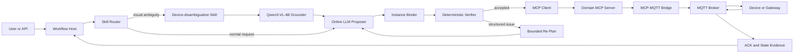

# HomeClaw

面向真实智能家居执行闭环的可恢复 Agent Runtime：在线大模型负责语义规划，Skill-MoE 负责稀疏能力编排，Qwen3-VL-4B Grounder 只负责视觉设备消歧，Host 通过 MCP–MQTT Bridge 执行领域动作，并以设备状态证据而不是“发布成功”判定任务完成。

当前开发分支：`production-ready`

> 本仓库同时保留早期 SAGE/HomeBench 学术评测与仿真入口。`homeclaw/agent`、`workflow`、`routing`、`verification`、`mcp_runtime`、`mqtt` 等目录构成 production-ready 工程主线；旧版 Coordinator、场景仿真和四系统对比作为兼容评测层继续保留。

## 核心原则

- Agent 主模型是 GPT、Gemini 等在线 LLM；Qwen3-VL-4B 只是 `device-disambiguation` Skill 内部的 Grounder。
- MCP 只暴露 `set_temperature`、`set_light_brightness` 等领域 Tool，不向 LLM 暴露原始 MQTT Topic。
- MQTT PUBACK、MCP 成功响应和消息队列 Publisher Confirm 都不等于设备执行成功；最终成功必须绑定业务 ACK 或匹配的 State Evidence。
- PostgreSQL 是 Workflow、Checkpoint、Registry、动作尝试和 Outbox 的真相源；Redis 是可重建缓存，RabbitMQ 是异步事件通道，MongoDB 保存时间化用户记忆。
- Skill-MoE 是工程上的 Top-K 稀疏门控与 Tool 子空间收缩，不是参数级神经网络 MoE。
- 生产 Agent 无权在线修改 Skill；演进只能经过离线回放、安全门禁、Evidence Pack、人工审批和 Canary。

## 一图速览



### Workflow 状态机

```text
Receive -> Route -> [Ground] -> Plan -> Verify -> Execute -> Confirm -> Complete
                         |          |          |          |
                         +-> Reject +-> RePlan +-> RePlan +-> Fail
```

`Ground` 仅在 Router 选中设备消歧 Skill 时进入。每个节点结束后保存 Checkpoint；Checkpoint 与 Outbox 在同一事务提交。默认执行预算为 24 Step、2 次 Re-Plan、16K Token 和 120 秒全局 Deadline。

## 系统组成

| 组件 | 部署位置与职责 | 关键边界 |
|---|---|---|
| Workflow Host | CPU 服务；维护状态机、DAG、预算、Checkpoint 和恢复 | 不让 LLM 直接决定执行成功 |
| Online Planner/Proposer | GPT、Gemini、Anthropic 或兼容端点 | 只生成结构化语义提议 |
| Skill Router | CPU 服务；倒排召回、动态 Top-K、低置信度回退 | 简单请求 Top-1，多意图/视觉请求 Top-2 |
| Qwen3-VL-4B Grounder | 独立 Docker GPU 服务 | 只处理视觉设备指代；不负责全局规划或 Verifier |
| Binder/Verifier | CPU 确定性模块 | 校验实例、Capability、参数、状态、风险、幂等和动作冲突 |
| MCP Server | 领域 Tool、Resource、Prompt 接口 | Tool 白名单、版本、RBAC、家庭租户隔离和高风险确认 |
| MCP–MQTT Bridge | MCP 服务或边缘网关侧 | 内部维护 Tool 到 Topic/Payload 映射，Topic 不进入模型上下文 |
| State Layer | Redis Cache + 设备/网关权威状态 | sequence CAS、TTL、GAP、Read-through 和周期对账 |
| Event Layer | RabbitMQ | Quorum Queue、Manual ACK、DLX/DLQ；不作为任务真相源 |
| Memory Layer | MongoDB | 时间化偏好、撤销历史、日/月摘要和用户隔离 |
| Observability | OpenTelemetry | 统一 Trace/Metric，敏感属性脱敏 |

### 关联标识

| 标识 | 生命周期 |
|---|---|
| `trace_id` | 一条端到端调用链 |
| `request_id` | 一次入口请求 |
| `task_id` | 一个可恢复 Workflow |
| `action_id` | 一条语义动作提议 |
| `command_id` | 一次可去重的设备命令；安全重试时保持不变 |
| `message_id` | 一条可由消费者去重的异步消息 |

## 关键能力

### 1. Skill-MoE 双层稀疏编排

1. Skill Registry 保存能力域、关键词、激活短语、Tool 引用和知识资源。
2. Router 使用倒排索引、关键词覆盖和能力分选择 Top-K Skill。
3. Host 只加载命中 Skill 的知识和 Tool Schema。
4. 家居拓扑先收缩候选设备。
5. Capability Registry 再删除候选设备不支持的 Tool。
6. 低置信度请求进入 clarification，而不是猜测动作。

共享 Tool 在 Registry 中只定义一次，多个 Skill 通过引用复用，避免重复 Schema 和权限漂移。

### 2. Grounder 知识锚定

- 使用 `home_id/room_id/capability` 先过滤视觉候选。
- 候选只有一台时跳过模型；仍有多台候选时才调用 Grounder。
- Grounder 返回候选集外设备、超时或低置信度时保持 ambiguous 并拒绝执行。
- Docker 服务提供 readiness、单请求和最多 16 条的批处理入口；模型 revision 必须固定。
- 本分支只实现推理部署与 Agent 接入，不包含 Qwen3-VL、LoRA 或 GRPO 训练代码。

部署说明见 [`deploy/grounder/README.md`](./deploy/grounder/README.md)。

### 3. Proposer–Binder–Verifier

Proposer 只能看到 Router 选中的 Tool；Binder 将语义别名绑定到注册设备；Verifier 不接受 Proposer 的自然语言自证，只校验结构化 `ActionProposal`：

- 设备是否存在、在线且属于当前家庭；
- Tool 是否由设备 Capability 支持；
- 参数类型、范围、未知字段和 Expected State；
- 状态是否新鲜；
- 风险、授权和幂等等级；
- 批动作中的冗余、设备冲突、环境冲突、资源竞争、阻塞和依赖环。

失败结果以结构化 issue 返回，并受最大 Re-Plan 次数限制。工程实现默认不需要把 Proposer 和 Verifier 包装成两个通过 A2A 通信的独立 Agent。

### 4. MCP Tools、Resources 与 Prompts

- **Tools**：版本化领域动作及输入 Schema，Host 只暴露被选中 Skill 的白名单。
- **Resources**：按需读取聚合设备状态与能力快照；高频原始传感器流不进入 LLM。
- **Prompts**：版本化规划、验证和异常解释模板；实时状态不固化在 Prompt 中。
- **Authorization**：校验 Principal、角色、家庭范围、策略版本和高风险确认，生产配置默认 fail-closed。

### 5. MQTT 执行与状态一致性

- 发布前先订阅 State/ACK，避免错过快速响应。
- Payload 携带稳定 `command_id`；QoS 1 重复投递由去重记录吸收。
- `set_temperature(26)` 等绝对目标可安全幂等；无法转换的 `toggle` 动作禁止自动重试。
- Diff 使用单调 sequence；重复、乱序和序号跳跃分别返回 `DUPLICATE`、`OUT_OF_ORDER` 和 `GAP`。
- GAP、缓存缺失或 TTL 过期时读取权威完整快照；`StateReconciler` 周期修复漏失事件。
- retained message 必须额外检查时间、设备在线状态、版本和命令关联。

### 6. 崩溃恢复与可靠性

- `WorkflowHost.resume(task_id)` 从最后一个已提交节点恢复。
- PostgreSQL Action Attempt 以 `task_id:action_id` 作为幂等键并保存原 `command_id`。
- 崩溃后已有终态证据直接复用；未完成动作继续等待原命令，不盲目补发新命令。
- 通用 Retry 默认最多 3 次，指数退避 0.1 秒起、2 秒封顶、10% 抖动。
- 连续 5 次失败打开熔断，30 秒后半开探测；非幂等操作始终只尝试 1 次。

### 7. 时间化记忆

偏好事实使用 append-only 模型，包含来源、置信度、作用域、`valid_at/invalid_at/expires_at` 和 supersedes 关系。冲突规则为：

1. 显式声明高于系统规则，高于行为推断；
2. 设备级高于房间级，高于情境级，高于全局；
3. 同优先级使用更新且仍有效的事实；
4. 撤销和替代只标记失效，不删除审计历史。

## 代码结构

### 亮点到代码的直接映射

| 工程亮点 | 核心实现 | 关键测试/评测 |
|---|---|---|
| **Skill-MoE 双层稀疏编排** | `routing/registry.py`、`router.py`、`contraction.py`；`skills/registry.json`；`resilience/controls.py` 中的动态 Top-K | `test_skill_router.py`、`test_tool_contraction.py`、`test_baseline_router.py`、`evaluate_router.py` |
| **Proposer–Binder–Verifier 有界博弈** | `agent/proposer.py`、`binder.py`、`runtime.py`；`verification/verifier.py`、`conflicts.py` | `test_production_runtime.py`、`test_instance_binder.py`、`test_verifier.py`、`test_conflicts.py` |
| **MCP–MQTT Bridge 与 False Done 防护** | `mcp_runtime/server.py`、`host.py`、`home_server.py`、`resources.py`；`mqtt/bridge.py`、`paho_adapter.py` | `test_mcp_runtime.py`、`test_mqtt_bridge.py`、`test_state_resources.py` |
| **受控 Skill 自进化** | `evolution/pipeline.py`、`gates.py`、`models.py`、`store.py`、`canary.py` | `test_evolution.py`；Evidence Pack、stale base 拒绝和 Canary 自动暂停 |
| **Checkpoint 与幂等恢复** | `workflow/engine.py`、`postgres_store.py`、`action_attempts.py`；`agent/runtime.py` 中的 `DurableActionDispatcher` | `test_workflow.py`、`test_postgres_checkpoint.py`、`test_durable_dispatcher.py` |
| **Qwen3-VL 设备消歧 Skill** | `grounding/service.py`、`client.py`、`capacity.py`；`topology/grounding.py`；`deploy/grounder/` | `test_grounding_service.py`、`test_capacity_wrappers.py` |

### 关键文件级目录树

```text
HomeClaw/
├── homeclaw/
│   ├── agent/
│   │   ├── runtime.py         # 生产组合根：Workflow→Router→Ground→Propose→Bind→Verify→MCP
│   │   │                      # MCPActionDispatcher / DurableActionDispatcher / ProductionRuntime
│   │   ├── proposer.py        # 在线 LLM 语义提议；只接收路由后的 Tool 子集
│   │   ├── binder.py          # 语义设备别名绑定到唯一 Registry 实例
│   │   └── capacity.py        # Planner 并发、QPS、在途 Token 和瞬态错误重试
│   │
│   ├── routing/               # Skill-MoE 第一层：能力级 Top-K 门控
│   │   ├── models.py          # ToolDefinition / SkillDefinition / RouteDecision
│   │   ├── registry.py        # Skill/Tool 唯一注册、引用和 Schema 校验
│   │   ├── router.py          # 倒排召回、混合打分、Top-K 与 clarification 回退
│   │   └── contraction.py     # Skill-MoE 第二层：按候选设备 Capability 收缩 Tool
│   ├── skills/
│   │   ├── registry.json      # lighting/climate/media/security/appliance/消歧 Skill 画像
│   │   └── smart-home/        # 早期 Skill 懒加载兼容实现
│   │
│   ├── verification/          # Proposer–Verifier 中的隔离验证侧
│   │   ├── registry.py        # ToolSpec、ParameterSpec、DeviceRecord、能力真相接口
│   │   ├── postgres_registry.py # Registry 乐观锁、同事务 Outbox、拓扑/能力版本
│   │   ├── verifier.py        # 实例、参数、状态新鲜度、风险与幂等校验
│   │   └── conflicts.py       # 冗余/设备/环境/资源/阻塞/依赖环冲突检测
│   │
│   ├── mcp_runtime/           # Function Calling 进入 MCP 的 Host/Server 边界
│   │   ├── server.py          # 版本化 MCP Tools、Resources、Prompts 与订阅语义
│   │   ├── host.py            # Tool 白名单 + RBAC + 家庭租户 + 高风险确认
│   │   ├── home_server.py     # 领域 Tool 注册及 Tool→Bridge Binding
│   │   ├── resources.py       # 聚合状态 Resource 与选择性更新通知
│   │   └── sdk_adapter.py     # 官方异步 MCP Session Adapter 与独立超时
│   ├── mqtt/                  # MCP–MQTT Bridge：不向模型暴露 Topic
│   │   ├── bridge.py          # command_id、订阅先于发布、业务 ACK/State Evidence
│   │   ├── paho_adapter.py    # 真实 Paho MQTT 连接、SUBACK、发布与等待
│   │   └── transport.py       # 可测试的 Transport 契约与内存实现
│   │
│   ├── workflow/
│   │   ├── state.py           # 显式节点、WorkflowState 与 Step/Re-Plan/Token/Deadline
│   │   ├── engine.py          # 节点执行、逐节点 Checkpoint、等待/恢复/明确终态
│   │   ├── store.py           # In-memory/SQLite Store 与 Outbox 契约
│   │   ├── postgres_store.py  # PostgreSQL Checkpoint + Outbox 原子事务
│   │   └── action_attempts.py # command_id、幂等键、执行证据与崩溃后恢复
│   │
│   ├── evolution/             # 受控 Skill-MoE 自进化，不允许在线自改生产
│   │   ├── pipeline.py        # FailureTrace→Candidate→Replay/Ablation→Gate→Canary
│   │   ├── models.py          # CandidateChange、EvaluationSnapshot、EvidencePack 哈希
│   │   ├── gates.py           # 可比性、收益和安全门禁；失败默认拒绝
│   │   ├── store.py           # Evidence Pack 原子持久化
│   │   └── canary.py          # 人工批准、小流量状态机、安全违规自动暂停
│   │
│   ├── grounding/
│   │   ├── service.py         # 拓扑候选锚定；单候选跳过模型，多候选调用 Grounder
│   │   ├── client.py          # HTTP 单条/批量推理、候选集外结果拒绝、readiness
│   │   └── capacity.py        # Grounder QPS、并发、队列时间和批处理保护
│   ├── topology/
│   │   ├── graph.py           # 家庭、房间、设备与关系图
│   │   └── grounding.py       # 基于房间/能力/邻接关系的知识锚定
│   │
│   ├── state/
│   │   ├── cache.py           # sequence、TTL、DUPLICATE/OUT_OF_ORDER/GAP
│   │   ├── redis_adapter.py   # Redis Lua CAS、幂等证据和租约
│   │   └── reconcile.py       # Read-through 权威回源与周期全量对账
│   ├── memory/
│   │   ├── preferences.py     # append-only 时间偏好与确定性冲突解决
│   │   ├── summaries.py       # 日/月摘要的源事件锚定与版本化
│   │   └── mongo_adapter.py   # Mongo 事务、唯一活跃事实及有限并发重试
│   ├── events/
│   │   ├── bus.py             # 版本化 Envelope 与消费者去重
│   │   └── rabbitmq_adapter.py # Quorum Queue、Manual ACK、DLX/DLQ
│   ├── security/authorization.py # Principal、RBAC、home scope、policy version
│   ├── resilience/controls.py # Retry、熔断、Semaphore、Token Bucket、动态 Top-K
│   ├── observability/         # 关联 ID Span、P50/P95、OTel Adapter 与脱敏
│   ├── domain/                # ActionProposal、ExecutionEvidence、错误与关联 ID
│   ├── eval/                  # 四策略、Router、冲突、状态一致性与性能评测
│   └── coordinators/          # 早期 SAGE/HomeBench 学术评测兼容层
├── data/
│   ├── eval/                  # Router Gold 与冲突规则自有数据
│   ├── homebench/             # HomeBench 自包含数据
│   └── sage/                  # SAGE 用户、记忆和图像资产
├── deploy/
│   ├── postgres/              # Workflow、Registry、Registry Outbox Migration
│   ├── mongodb/               # 偏好唯一索引
│   ├── grounder/              # Qwen3-VL-4B Docker GPU 推理服务
│   └── compose.infrastructure.yaml # PostgreSQL/Redis/Mongo/RabbitMQ/MQTT 验收拓扑
├── tests/
│   ├── test_skill_router.py / test_tool_contraction.py
│   ├── test_production_runtime.py / test_verifier.py / test_conflicts.py
│   ├── test_mcp_runtime.py / test_mqtt_bridge.py / test_state_resources.py
│   ├── test_evolution.py / test_workflow.py / test_durable_dispatcher.py
│   └── smoke_m1.py ... smoke_p7.py
├── scripts/                    # verify、Router/冲突评测、外部预检、HTTP 压测
├── reports/                    # 仓库自有离线原始报告
└── docs/                       # 架构、ADR、Benchmark、外部验收和运行手册
```

## 快速验收

要求 Python 3.10 及以上。以下命令不需要额外安装 production 依赖，也不会连接数据库、Broker、在线模型或 GPU：

```powershell
python scripts/verify.py --suite all
python scripts/evaluate_router.py --output reports/router-eval.json
python scripts/evaluate_conflicts.py --output reports/conflict-eval.json
python scripts/external_preflight.py --output reports/external-preflight.json
```

其中 `external_preflight.py` 只检查可选模块、配置名和部署资产是否存在，不读取密钥值，也不启动服务。

### 早期学术评测兼容入口

```powershell
python run_experiment.py --provider mock --limit 60
```

该入口保留 HomeClaw、SAGE、Sasha、OnePrompt 四系统对比以及 HomeBench/SAGE 评测。`mock` 数字只用于链路验证，不能作为模型效果结论。真实在线模型示例：

```powershell
$env:OPENAI_API_KEY = "YOUR_API_KEY"
python run_experiment.py --provider openai --model MODEL_VERSION --limit 200
```

## 可复现的当前证据

以下结果来自当前仓库的离线报告和本机回归，不代表在线生产环境：

| 项目 | 当前结果 | 适用范围 |
|---|---:|---|
| Production 单元/进程内集成测试 | 123/123 通过 | 代码与故障语义回归 |
| 原项目 Smoke | M1–M6、P1–P7 共 8 组通过 | 学术原型兼容性 |
| Router Top-2 Recall@2 | 100% | 25 条仓库自有 Gold 集 |
| Router Top-2 多标签完整覆盖率 | 100% | TF-IDF 基线为 88% |
| Top-2 Schema 收缩 | 2406 → 928.72 Bytes，减少 61.4% | 序列化 Tool Schema 体积 |
| 5000 Skill 路由 | P95 约 0.372 ms，约 2976 QPS | 当前本机离线 CPU 进程 |
| 5000 Skill 索引峰值 | 约 16.3 MB | 合成扩展 Registry |
| 5000 候选设备 Tool 收缩 | P95 约 1.378 ms | 内存 Capability 收缩 |
| 冲突规则回归 | 8 条合成用例，Precision/Recall/F1/Exact Match 均为 1.00 | 规则覆盖，不是真实家庭分布 |

原始证据：

- [`reports/router-eval-2026-11-09.json`](./reports/router-eval-2026-11-09.json)
- [`reports/conflict-eval-2026-11-09.json`](./reports/conflict-eval-2026-11-09.json)
- [`reports/external-preflight.json`](./reports/external-preflight.json)

项目材料中还保留“长程复杂指令成功率相对基线提升 25%”和“细粒度设备实体识别准确率 84%”两个已有研究/简历口径；它们不是上述离线路由或单测报告产生的数字，正式引用时必须同时提供原实验数据、模型版本、测试集和统计口径。

## 真实环境部署与验收

生产 Adapter 的可选依赖定义在 `pyproject.toml` 的 `production` extra 中。仓库提供部署资产，但不会自动安装依赖、拉取镜像或启动服务：

- [`deploy/compose.infrastructure.yaml`](./deploy/compose.infrastructure.yaml)：PostgreSQL、Redis、MongoDB、RabbitMQ、MQTT 验收拓扑；
- [`deploy/postgres/`](./deploy/postgres/)：Workflow、Registry 和 Outbox Migration；
- [`deploy/grounder/`](./deploy/grounder/)：Qwen3-VL-4B 推理服务；
- [`docs/external-acceptance.md`](./docs/external-acceptance.md)：真实基础设施验收矩阵；
- [`docs/benchmark-protocol.md`](./docs/benchmark-protocol.md)：四策略对比、容量和指标协议；
- [`docs/operations-runbook.md`](./docs/operations-runbook.md)：发布、恢复、Outbox、MQTT 和回滚手册。

隔离验收环境中的 Mosquitto 示例允许匿名访问，仅用于本地测试，禁止直接作为生产 Broker 配置。Grounder 镜像必须固定不可变模型 revision，在线 LLM 实验必须固定模型版本、Prompt、数据哈希、预算和随机种子。

## 文档导航

- [Production-Ready 实施计划](./production-ready-plan.md)
- [Production-Ready 架构](./docs/production-ready-architecture.md)
- [外部环境验收清单](./docs/external-acceptance.md)
- [实验与容量验收协议](./docs/benchmark-protocol.md)
- [运行与恢复手册](./docs/operations-runbook.md)
- [架构决策记录](./docs/adr/)
- [深度面试 Q&A](./Q&A.md)
- [早期设计草案](./00-设计草案.md)

## 当前边界

- 本仓库没有实现 Qwen3-VL、LoRA 或 GRPO 训练，只实现 Grounder 推理部署和 Agent 接入。
- 当前 Router、冲突、状态与恢复数字来自离线/进程内验收，不能冒充在线 LLM、真实家庭或 GPU 生产指标。
- PostgreSQL、Redis、MongoDB、RabbitMQ、MQTT、MCP SDK、OpenTelemetry、在线模型和 GPU 的真实验收需要在准备好的外部环境中单独执行。
- 任何参考仓库或论文指标都不能直接写成 HomeClaw 自有结果。
