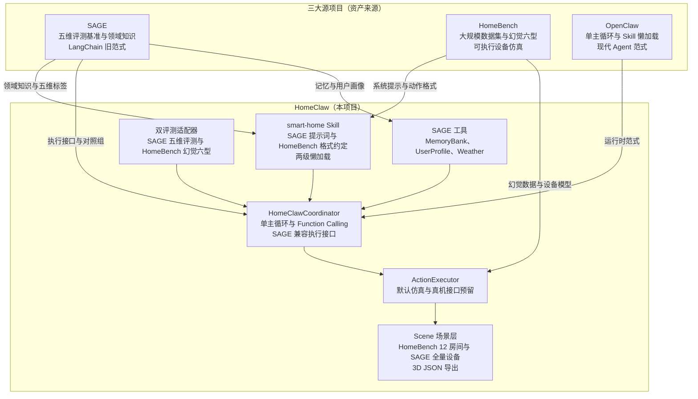

# HomeClaw

> 把 **SAGE** 的学术资产（五维评测基准 + 智能家居领域知识）搬进 **OpenClaw** 的现代 Skill 范式，
> 融合 **HomeBench** 的大规模幻觉评测数据集，构建一个**能多维度衡量、能测幻觉、能仿真动作输出、
> 并预留真机接口**的下一代智能家居 Agent 与 Benchmark。

- 详细设计见 [`00-设计草案.md`](./00-设计草案.md) 及 `01~06` 系列设计文档。
- 本文只讲三件事：**整体代码架构 · 一图速览 · 一键实验步骤**。

---

## 一、一图速览



**数据流（一条指令的生命周期）**：

```
用户指令 → HomeClawCoordinator.execute()
   → loop.py 单主循环：注入 Skill 规则速览 → LLM
   → （复杂指令）READ_SKILL 拉全文 → LLM 再生成
   → 产出动作文本 room.device.operation(param)
   → parser 解析 → Executor 落地（仿真改内存 / 真机调云 API）
   → snapshot 快照 → 评测适配器断言 / 3D 场景实时渲染
```

---

## 二、整体代码架构

```
HomeClaw/
├── homeclaw/              # 核心包
│   ├── loop.py      # OpenClaw 式单主循环内核（LLM→工具→回灌→再循环）
│   ├── prompt.py        # 两级懒加载 system prompt 构建（规则速览 + 按需全文）
│   ├── llm.py # Provider 无关 LLM 层：mock/openai/anthropic/local(HF)
│   ├── config.py        # LLMConfig / SkillConfig / CoordinatorType / build_coordinator
│   ├── data_paths.py            # 数据/模型路径统一配置（数据自包含，零跨项目引用）
│   │
│   ├── coordinators/     # 四系统编排器
│   │   ├── homeclaw_coordinator.py  # HomeClaw 主编排（懒加载 + Function-Calling）
│   │   ├── baselines.py   # OnePrompt / Sasha / SageBridge 三对照组
│   │   └── base.py           # Coordinator 抽象 + ExecuteResult
│   │
│   ├── skills/smart-home/       # smart-home Skill（SKILL.md，含规则速览段）
│   │
│   ├── executor/              # 执行层（动作文本 → 状态变更 / 真机调用）
│   │   ├── parser.py    # 解析 room.device.operation(param) / error_input
│   │   ├── simulate_executor.py     # 内存仿真执行器（默认）
│   │   ├── condition_monitor.py     # 持久化条件监控（Persistence 维度）
│   │   ├── real_executor.py         # 真机执行器（预留）
│   │   ├── cloud_adapter.py# SmartThings / HomeAssistant / Mock 云适配器
│   │   └── factory.py               # make_executor：sim/mock_cloud/smartthings/homeassistant
│   │
│   ├── devices/device.py        # HomeBench 16 类 + SAGE 特有设备类（TV/冰箱/洗碗机…）
│   │
│   ├── scene/       # 场景层（P2/P6）
│   │   ├── schema.py     # Scene/Room/DeviceSlot（含 3D 坐标 + anchors）
│   │   ├── homebench_scene.py       # HomeBench 12 房间拓扑
│   │   ├── sage_scene.py            # SAGE 全量设备场景 + 覆盖度自检
│   │   └── export.py      # 导出 3D 可视化 JSON（供前端 / P7）
│   │
│   ├── tools/  # SAGE 原子智能体在 HomeClaw 的落地（P3）
│   │   ├── memory_bank.py           # 记忆库：auto 检索器（有 sentence-transformers 走真实向量，否则关键词降级）
│   │   ├── user_profile.py          # 用户画像 + 记忆检索（个性化核心）
│   │   ├── device_disambiguation.py # 设备消歧：默认真实 CLIP 图文相似度（缺依赖时文本兜底）
│   │   └── weather / human_interaction / api_planner
│   │
│   ├── eval/      # 双评测体系
│   │   ├── sage_adapter.py          # SAGE 五维评测（动态执行断言）
│   │   ├── sage_cases.py      # 从 SAGE 官方迁移的五维用例集
│   │   ├── sage_dataset.py          # SAGE 数据加载（画像/记忆）
│   │   ├── homebench_adapter.py     # HomeBench 幻觉六型评测（EM/P/R/F1）
│   │   └── metrics.py               # 指标计算
│   │
│   └── runners/__init__.py      # SageRunner / HomeBenchRunner + 数据来源标注
│
├── data/ # 数据自包含（无跨项目引用）
│   ├── homebench/            # HomeBench 数据集 *.jsonl
│   └── sage/       # SAGE user_info / memory
│
├── models/# 本地开源模型权重（download_models.py 下载到此）
├── tests/  # smoke_m1~m6 + smoke_p1_p6 冒烟测试
│
├── run_experiment.py      # 一键四系统对比实验入口
├── download_models.py         # 本地开源模型下载脚本（hf-mirror 镜像）
├── export_scenes.py          # 场景 3D JSON 导出 CLI
└── 00-设计草案.md ~ 06-3D场景可视化实施方案.md   # 设计与实施文档
```

### 关键设计
- **编排内核**：OpenClaw 式单主循环 + 原生 Function-Calling，摆脱 LangChain ReAct 文本解析。
- **能力组织**：扁平 Skill 两级懒加载（规则速览始终注入 + 完整策略按需 `READ_SKILL`），简单指令省 token。
- **动作格式**：统一 `room.device.operation(param)` / `error_input`，仿真与真机零改格式。
- **多模态设备消歧**：`DeviceDisambiguationTool` 默认走**真实 CLIP 图文相似度**，结合 `data/sage/images/` 的实景照片 + 空间锚点（by the credenza / plant …）在同类多设备间消歧；缺 `open_clip`/`torch` 时回退文本兜底并如实标注后端（`backend=="text"`）。
- **向量记忆检索**：`MemoryBank` 默认 auto 策略，装了 `sentence-transformers` 即自动启用**真实向量语义检索**（与 SAGE 原始向量库对齐），否则回退关键词并标注（`retriever_kind=="keyword"`）。
- **四系统对比**：HomeClaw vs SAGE / Sasha / OnePrompt，同一数据、同一指标。
- **数据自包含**：SAGE + HomeBench 数据集全部拷入 `data/`，可独立复现。

### SAGE 原子智能体在 HomeClaw 的落地对照

| SAGE 原子智能体 | HomeClaw 实现 | 真实能力 | 降级回退（缺依赖时） |
|---|---|---|---|
| MemoryBank（向量库检索） | `memory_bank.py` | sentence-transformers 向量语义检索 | 关键词重叠（标注 `keyword`） |
| UserProfile（个性化） | `user_profile.py` | 结构化偏好 + 记忆召回注入 prompt | —（真实） |
| DeviceDisambiguation（VLM 视觉消歧） | `device_disambiguation.py` | **open_clip CLIP 图文相似度 + 实景图** | 锚点/名称文本兜底（标注 `text`） |
| WeatherTool | `weather.py` | 可接 OpenWeatherMap（设 `OPENWEATHER_API_KEY`） | 确定性 mock（可复现） |
| HumanInteraction（追问澄清） | `human_interaction.py` | 回调应答 + 提问记录 | 预设默认答复 |
| ApiUsagePlanner | `api_planner.py` | 意图→受支持操作的规划 | —（规则版） |

> 所有工具的实际后端都可在运行时如实报告（`backend` / `retriever_kind` / `is_semantic`），
> 便于论文方法学标注结果是否为多模态/向量真实实现，杜绝"声称多模态却无实现"的隐患。

---

## 三、一键实验步骤

HomeClaw 学术实验**以云端完整大模型 API 为主**（对齐 SAGE 在线 API 方式），
同时提供"本地部署开源模型"路径（复现 HomeBench）。

### 0. 离线冒烟（无需 API，验证链路）

```bash
cd HomeClaw
python3 run_experiment.py --provider mock --limit 60

# 回归测试
python3 tests/smoke_m6.py       # 关键局限修复验证
python3 tests/smoke_p1_p6.py    # 六阶段回归（数据/场景/工具/本地模型/真机/3D）
```

### 1. 云端 API（主路径）

```bash
export OPENAI_API_KEY=sk-...
python3 run_experiment.py --provider openai --model gpt-4o-mini --limit 200

# 或 Anthropic
export ANTHROPIC_API_KEY=...
python3 run_experiment.py --provider anthropic --model <model> --limit 200
```

### 2. 本地开源模型（复现 HomeBench 本地部署）

先下载权重到 `HomeClaw/models/`：

```bash
hf auth login
export HF_ENDPOINT=https://hf-mirror.com
export HF_TOKEN=YOUR_HF_TOKEN
python download_models.py
```

生成 `models/{llama3-8b-Instruct, Qwen2.5-7B-Instruct, Mistral-7B-Instruct-v0.3, Gemma-7B-Instruct-v0.3}/`，
再用本地权重跑（`--model` 传 **sub_dir 名**，自动解析到 `models/<sub_dir>`）：

```bash
# 2a) 进程内 transformers 加载（需 pip install torch transformers accelerate）
python3 run_experiment.py --provider local --model Qwen2.5-7B-Instruct --limit 200

# 2b) 或 vLLM/Ollama 起 OpenAI 兼容服务后指向它
python3 run_experiment.py --provider openai_compatible \
    --base-url http://localhost:8000/v1 --model qwen2.5-7b --limit 200
```

### 3. SAGE 多模态 / 向量模型（device_resolution + personalization 的真实对比前提）

要与 SAGE 在**设备消歧（视觉）**与**个性化（记忆向量检索）**两维做**公平对比**，
必须下载并启用真实的 CLIP 与句向量模型，否则这两维跑的是文本/关键词降级版，
其数字**不可**与 SAGE 官方结果直接比较：

```bash
pip install -r requirements.txt           # 含 open_clip_torch / sentence-transformers / pillow
python download_models.py --clip --embed  # 下载 CLIP(ViT-B-32) + all-MiniLM-L6-v2
```

生成 `models/clip/ViT-B-32.pt` 与 `models/sentence-transformers/all-MiniLM-L6-v2/`。
装好后：`DeviceDisambiguationTool` 自动走真实 CLIP（`backend=="clip"`），`MemoryBank`
自动走真实向量检索（`retriever_kind=="embedding"`），实验报告会如实反映后端。

> 若未安装：`device_resolution` 的视觉用例回退锚点文本兜底、`personalization` 回退关键词检索，
> 程序仍可跑通，但须在论文方法学中标注为降级实现（运行时后端字段会显示 `text` / `keyword`）。

### 4. 可选开关

```bash
# 让 SAGE 位走官方 LangChain 实现（需本机 SAGE 环境）
SAGE_ENABLE_OFFICIAL=1 python3 run_experiment.py --provider openai --model gpt-4o-mini

# SAGE 五维切真机执行后端
python3 run_experiment.py --provider openai --model gpt-4o-mini \
    --executor smartthings# sim(默认)/mock_cloud/smartthings/homeassistant
```

### 输出内容

一次实验产出三段对比：
1. **HomeBench 幻觉六型** · 四系统 OVERALL + 分型 EM/P/R/F1；
2. **SAGE 五维 + 新增维度**（过度执行率 / 拒答率 / 平均轮数 / token / 延迟）· 四系统对比；
3. **懒加载省 token 量化**（同内核 lazy on/off 对比）。

> ⚠️ `--provider mock` 的所有数字仅为链路验证值，**不能作为论文结论**；报告顶部会标注数据来源。
> 真实系统间差异需接入真实 LLM 后才会显现。

---

## 四、参与评测的四个系统

| 系统 | 说明 |
|---|---|
| **HomeClaw** | 本项目：单主循环 + Skill 两级懒加载 + Function-Calling |
| **SAGE** | 完整 ReAct 领域推理；`SAGE_ENABLE_OFFICIAL=1` 可桥接官方 LangChain 实现 |
| **Sasha** | 真两阶段管线（规划 → 动作，`iters=2`） |
| **OnePrompt** | 单轮裸提示基线（最短 prompt） |
