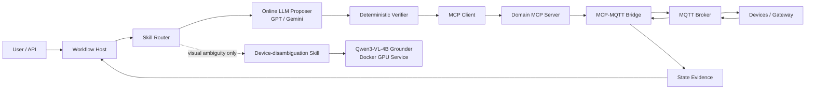
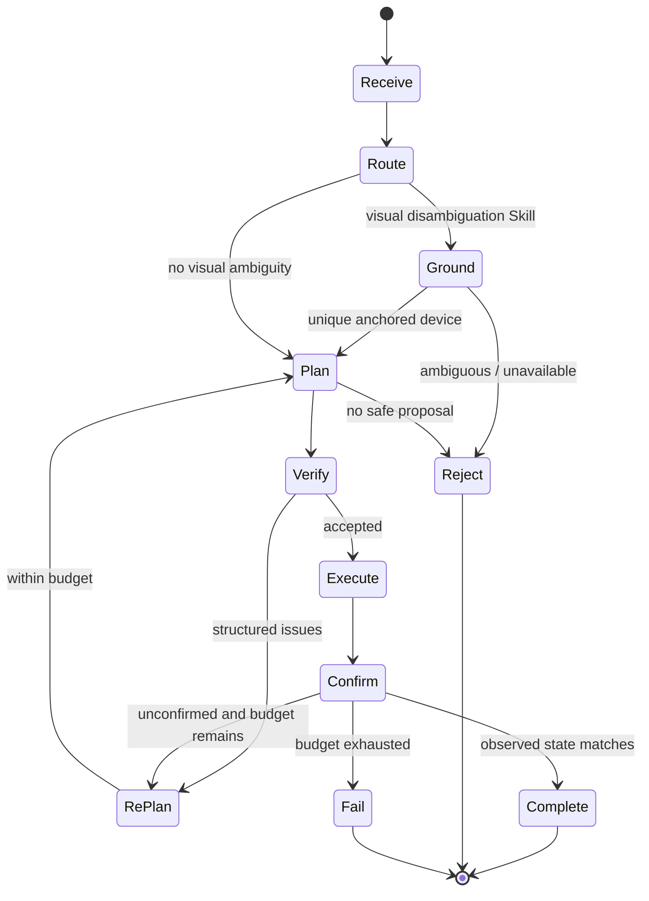

# HomeClaw Production-Ready 架构

本文描述 `production-ready` 分支中已经建立的运行边界。训练 Qwen3-VL、LoRA 和 GRPO 不在本仓库实施范围内。

## 1. 运行拓扑



### 主模型与 Grounder

- 主 Agent 使用在线大模型，负责语义提议和规划。
- Qwen3-VL-4B 只处理视觉设备指代，不承担 Agent 全局规划。
- 拓扑和能力信息先过滤视觉候选；只有候选仍超过一个时才调用 Grounder。
- Grounder 超时或返回候选集外设备时保持“有歧义”，禁止猜测。
- Runtime 命中设备消歧 Skill 后显式进入 `GROUND` 节点；成功结果写入候选设备上下文，内部 `ground_visual_device` 不再暴露给后续物理动作规划。

## 2. Workflow 状态机



每个节点结束后保存完整 Checkpoint。Checkpoint 与 Outbox 事件在同一事务提交。节点处理进程崩溃时，恢复逻辑从最后一个已提交节点重新执行。

## 3. 消息与 Blackboard

跨模块对象位于 `homeclaw/domain`，不允许供应商 SDK 对象越过边界。

| 标识 | 作用 |
|---|---|
| `trace_id` | 一次端到端链路 |
| `request_id` | 一次入口请求 |
| `task_id` | 一个可恢复 Workflow |
| `action_id` | Proposer 产生的语义动作 |
| `command_id` | 可去重的设备命令，重试时保持不变 |
| `message_id` | 一条内部消息，用于消费者去重 |

- PostgreSQL 是 Workflow、Checkpoint、动作尝试及 Outbox 的真相源。
- RabbitMQ 只用于拆分服务后的异步传播；模块化单体内使用直接调用。
- RabbitMQ Publisher Confirm、MCP 成功响应和 MQTT PUBACK 都不是设备成功证据。
- RabbitMQ 消费队列为 Quorum Queue，失败消息进入独立 DLX/DLQ；Envelope 版本不兼容时拒绝处理。

## 4. Skill-MoE 与工具收缩

HomeClaw 的 Skill-MoE 是工程上的稀疏门控，不是神经网络 MoE：

1. 倒排索引召回相关 Skill。
2. 关键词覆盖、能力画像和可用性参与排序。
3. Router 选择 Top-K Skill。
4. 只加载这些 Skill 的知识资源和 Tool Schema。
5. 家居拓扑先锚定候选设备。
6. Capability Registry 再删除候选设备不支持的 Tool。

全局安全工具（例如澄清请求）保留在最小工具集合内。错误路由允许有限次数的反馈式 Re-Plan，受 Workflow 步数、Token 和 Deadline 约束。

## 5. Verifier 隔离

Verifier 不读取 Proposer 的自然语言“自证”，只接受结构化 `ActionProposal`，并检查：

- 设备是否存在及在线；
- Tool 是否在设备能力注册表中；
- 参数类型、范围和未知字段；
- 状态是否新鲜；
- 幂等等级和风险授权；
- 动作批次中的冗余、设备冲突、环境冲突、阻塞、资源竞争和依赖环。

验证失败返回机器可读 issue，Proposer 只能在限轮预算内重新规划。

## 6. MCP 与 MQTT

### MCP

- Tools：领域动作，例如 `set_light_brightness`。
- Resources：聚合状态和能力快照，不是传感器原始流。
- Prompts：规划、验证和异常解释模板。
- Host 仅暴露被选中 Skill 的 Tool 白名单。
- 可选授权策略在调用前校验认证主体、家庭租户范围、角色、策略版本和高风险确认；未配置规则时按生产策略 fail-closed。
- Tool、Resource、Prompt 均携带接口版本；官方异步 MCP Session Adapter 有独立超时。

### MQTT

- Bridge 内部维护 Tool 到 `command_topic/state_topic` 的映射。
- Topic 永远不进入 Agent Tool Schema。
- `command_id` 写入命令 Payload，并与状态事件关联。
- 只有匹配 `expected_state` 的状态事件才能生成 `SUCCEEDED` 证据。
- 没有状态证据时为 `UNKNOWN`，随后进入有限 Re-Plan 或失败，而不是 False Done。
- 设备返回与 `command_id` 匹配的业务拒绝时为 `REJECTED`；Broker 不可用时为可重试依赖失败，二者不混成普通超时。

## 7. 状态缓存与一致性

- Redis Adapter 使用设备单调 `sequence` 执行 CAS。
- 重复或乱序 Diff 不覆盖较新状态。
- 增量 Diff 出现序号跳跃时返回 `GAP`，不把缺字段的局部更新伪装成完整状态；只有权威完整快照能跨版本修复。
- Read-through 服务在缓存缺失/过期时回源，并记录 hit、miss 和 stale fallback。
- 缓存项包含采集时间、过期时间、来源及 stale 语义。
- retained message 仍需检查时间、在线状态和必要的主动查询。
- `StateReconciler` 周期读取权威状态，修复漏失 Diff。
- 高频事件只更新 Resource 快照；异常谓词或用户关注条件成立时才发送 Resource 更新通知。

## 8. 用户记忆

偏好事实采用追加式时间模型：

- `valid_at`、`invalid_at`、`expires_at`；
- 来源和置信度；
- global/context/room/device 作用域；
- 显式声明优先于系统规则和行为推断；
- 更具体作用域优先于全局偏好；
- 被替代事实保留在历史中，不物理覆盖。

日/月摘要记录源事件 ID 和版本，同一事件集合重复运行不会产生新版本。
MongoDB 活跃偏好有唯一约束；重复键和瞬时事务冲突有限重试，其他 Schema 错误不重试。

## 9. 可靠性与容量

- 只重试幂等或带幂等键的操作；非幂等动作不盲重试。
- 指数退避带抖动，外部服务配置熔断和半开探测。
- Workflow 有最大步骤、Re-Plan 次数、Token 预算和全局 Deadline。
- LLM/Grounder 使用独立并发门、QPS Token Bucket 和动态 Top-K。
- 在线 Planner 额外使用在途 Token 池；排队超时、QPS 拒绝和预算耗尽进入机器可读终态，仅传输类错误允许有限重试。
- Grounder Docker 只运行一个 GPU Worker，模型内部使用锁避免并发生成导致显存不可控；生产容量测试后再调整批处理。

## 10. 可观测性

统一 Span 名称：

- `workflow.<node>`
- `router.retrieve`
- `planner.generate`
- `grounder.infer`
- `verifier.check`
- `mcp.call`
- `mqtt.publish`
- `mqtt.wait_state`

所有 Span 传播同一组关联 ID。内存实现用于单测；`OpenTelemetryAdapter` 用于部署环境。密钥、Authorization、Cookie 和 Token 属性在进入观测系统前会被脱敏。

## 11. 自进化边界

生产运行时不能直接修改 Skill 或 Router。允许的流程是：

```text
失败轨迹 -> 候选变更 -> 固定集回放 -> 可比性检查 -> 安全门禁
         -> 小流量 Canary -> 人工批准 -> 晋级 / 自动暂停 / 回滚
```

每个候选生成带内容哈希的 Evidence Pack。数据集、模型、Prompt、随机种子或 Token 预算不同的结果不可比较，门禁默认拒绝。
离线流水线从结构化失败轨迹生成可审查候选，执行固定集回放和消融，拒绝 stale base version；门禁通过只代表可进入 Canary，仍不能直接修改生产 Registry。

## 12. 验证方式

不安装额外依赖即可运行：

```powershell
python scripts/verify.py --suite unit
python scripts/verify.py --suite smoke
python scripts/evaluate_router.py --output reports/router-eval.json
```

外部基础设施、在线模型和 GPU 验收必须在对应部署环境中单独执行，不能用内存 Adapter 的结果冒充。
可先运行 `python scripts/external_preflight.py` 做不联网、不启动服务的只读预检，具体清单见 `docs/external-acceptance.md`。
